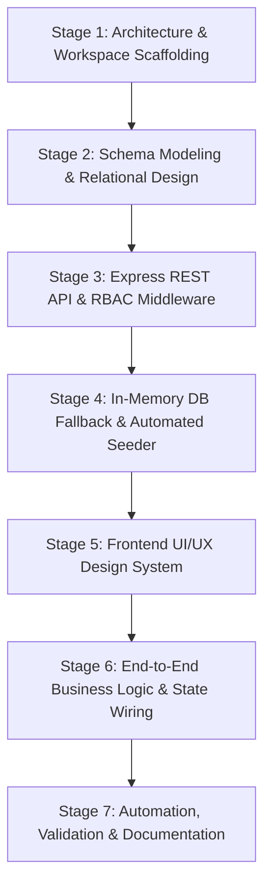
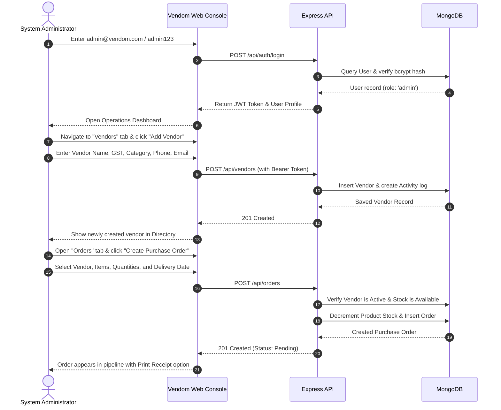
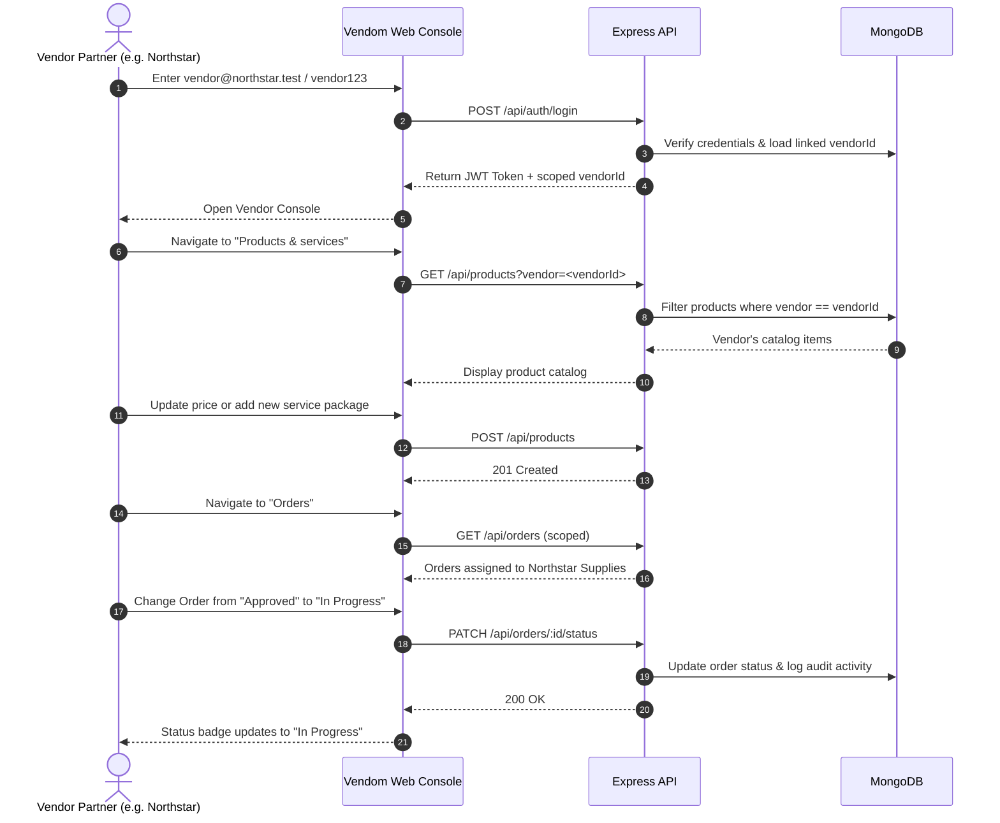
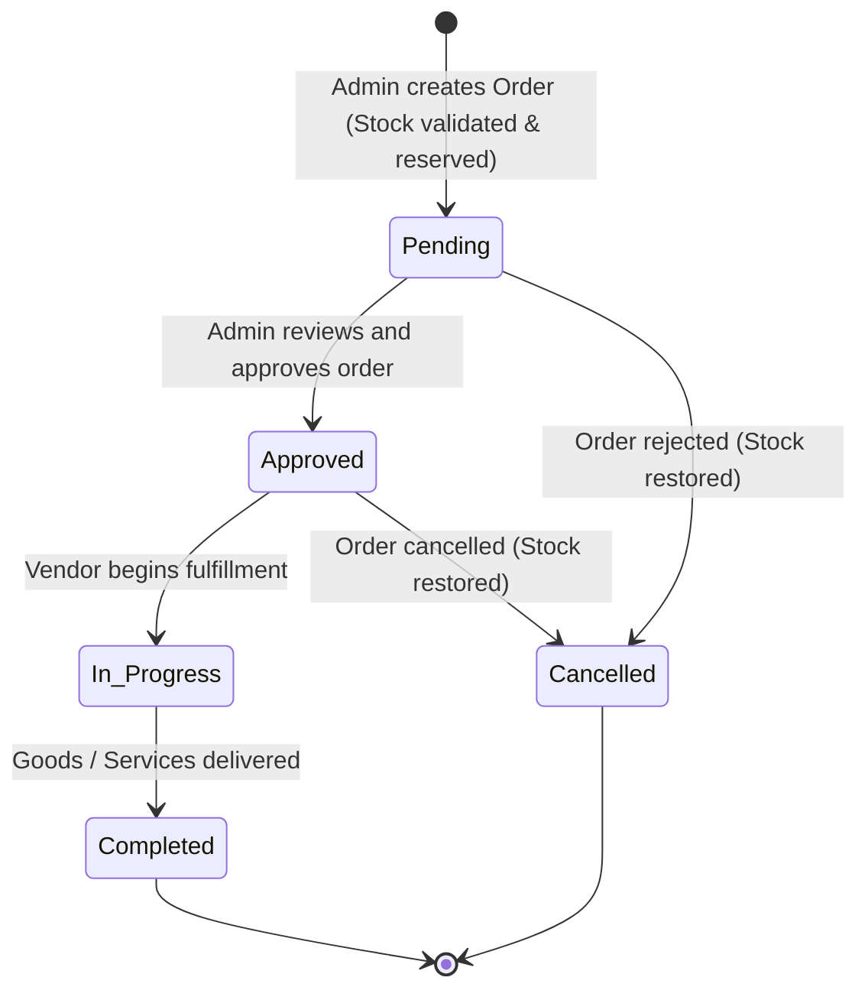
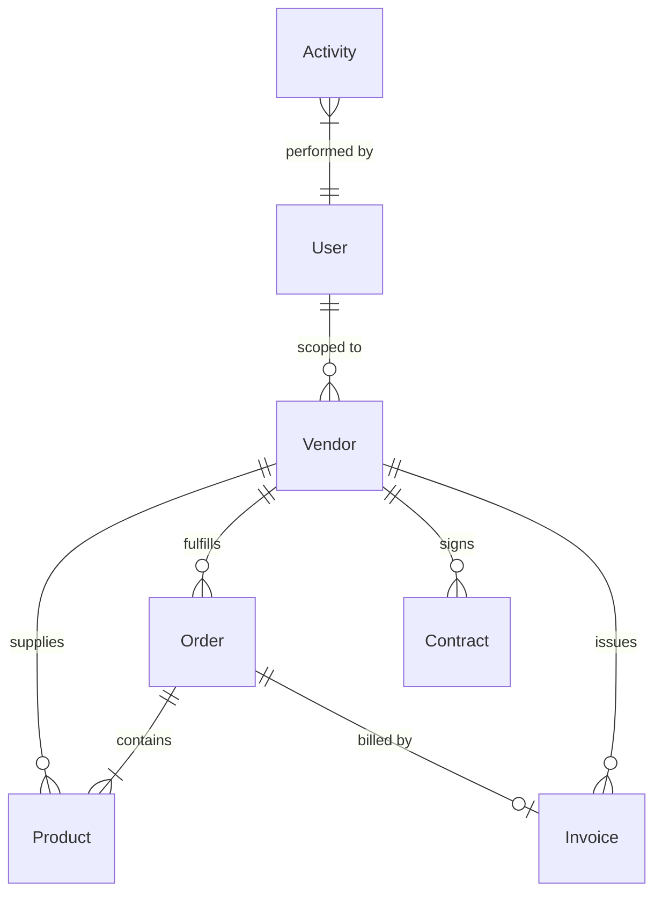

# Vendom — Full Implementation Plan & Project Blueprint

> **Document Version:** 1.0.0  
> **Project:** Vendom — Enterprise Vendor Management System (VMS)  
> **Architecture:** Full-Stack MERN (MongoDB / In-Memory, Express.js, React 19, Node.js)  
> **Target Audience:** Engineering Team, Evaluators, Project Reviewers, and Stakeholders  

---

## Table of Contents

1. [Executive Summary](#1-executive-summary)
2. [Project Conception & System Architecture](#2-project-conception--system-architecture)
   - [2.1 Business Problem & Solution Vision](#21-business-problem--solution-vision)
   - [2.2 High-Level Architecture](#22-high-level-architecture)
   - [2.3 Technology Stack Decisions & Justifications](#23-technology-stack-decisions--justifications)
3. [The Workflow of Making: How We Built It (Development Journey)](#3-the-workflow-of-making-how-we-built-it-development-journey)
   - [Stage 1: Workspace & Root Orchestration Setup](#stage-1-workspace--root-orchestration-setup)
   - [Stage 2: Database Modeling & Relational Integrity](#stage-2-database-modeling--relational-integrity)
   - [Stage 3: Backend RESTful API & Security Middleware](#stage-3-backend-restful-api--security-middleware)
   - [Stage 4: Zero-Config In-Memory MongoDB Engine & Realistic Seeding](#stage-4-zero-config-in-memory-mongodb-engine--realistic-seeding)
   - [Stage 5: UI/UX System & Modular Component Engineering](#stage-5-uiux-system--modular-component-engineering)
   - [Stage 6: End-to-End Business Logic Wiring](#stage-6-end-to-end-business-logic-wiring)
   - [Stage 7: Developer Experience & Launch Automation](#stage-7-developer-experience--launch-automation)
4. [User Workflows & Operational Journeys](#4-user-workflows--operational-journeys)
   - [4.1 System Actors & Permissions Matrix](#41-system-actors--permissions-matrix)
   - [4.2 Workflow A: System Administrator Journey](#42-workflow-a-system-administrator-journey)
   - [4.3 Workflow B: Vendor User Journey](#43-workflow-b-vendor-user-journey)
   - [4.4 Core Business Lifecycle Workflows](#44-core-business-lifecycle-workflows)
     - [A. Vendor Onboarding Lifecycle](#a-vendor-onboarding-lifecycle)
     - [B. Purchase Order (PO) State Machine](#b-purchase-order-po-state-machine)
     - [C. Contract Lifecycle & SLA Governance](#c-contract-lifecycle--sla-governance)
     - [D. Invoicing & Payment Reconciliation](#d-invoicing--payment-reconciliation)
     - [E. 6-Dimension Performance Evaluation Cycle](#e-6-dimension-performance-evaluation-cycle)
5. [Complete Module Breakdown & Features](#5-complete-module-breakdown--features)
6. [Data Dictionary & Database Schemas](#6-data-dictionary--database-schemas)
7. [API Specification & Route Architecture](#7-api-specification--route-architecture)
8. [Security, Guardrails & Error Handling](#8-security-guardrails--error-handling)
9. [Verification, Testing & Demonstration Guide](#9-verification-testing--demonstration-guide)
10. [Future Roadmap & Extensibility](#10-future-roadmap--extensibility)

---

## 1. Executive Summary

**Vendom** is a centralized Enterprise Vendor Management System (VMS) engineered to solve traditional inefficiencies in vendor onboarding, catalog management, purchase order fulfillment, SLA contract oversight, and accounts payable tracking.

The system bridges communication between **Procurement Officers / System Administrators** and **External Vendor Partners** through a unified web-based operating console. It provides real-time tracking, granular role-based access control, automated audit activity trails, and dynamic performance scorecards.

---

## 2. Project Conception & System Architecture

### 2.1 Business Problem & Solution Vision

| Problem in Conventional Operations | How Vendom Solves It |
|---|---|
| Vendor details, agreements, and tax IDs scattered across spreadsheets and emails. | **Centralized Vendor Profiles** containing GST, contact info, ratings, and active statuses. |
| Delays and stock discrepancies during order placement. | **Integrated Catalog with Real-Time Stock Validation** linked directly to vendor profiles. |
| Lack of visibility into contract expiration and SLA terms. | **Contract Repository** tracking valuation, validity ranges, status, and legal conditions. |
| Late invoice submissions and untracked payment milestones. | **Accounts Payable Tracking** tying invoices directly to Purchase Orders. |
| Subjective vendor performance appraisals. | **6-Dimension Scorecard** assessing Quality, Delivery, Pricing, Communication, Reliability, and Compliance. |
| Complex environment setup barriers for demonstrations and evaluators. | **Zero-Config Dual-Mode Engine** automatically running an in-memory database if no local MongoDB service is found. |

---

### 2.2 High-Level Architecture

```text
┌────────────────────────────────────────────────────────────────────────┐
│                        PRESENTATION LAYER                              │
│  React 19 SPA (Vite 6, Lucide React, Custom CSS Responsive System)    │
│  - Operations Dashboard       - Orders & PO Tracking                   │
│  - Vendor Directory & Profile - Contracts & SLAs                       │
│  - Products & Services        - Invoices & Accounts Payable            │
│  - 6-Metric Performance       - User Management & Settings             │
└───────────────────────────────────┬────────────────────────────────────┘
                                    │ HTTP / JSON / Bearer JWT
                                    ▼
┌────────────────────────────────────────────────────────────────────────┐
│                        APPLICATION API LAYER                           │
│  Express.js (Node.js REST API Server)                                  │
│  - JWT Authentication Middleware    - Role-Based Access Control (RBAC) │
│  - Business Validation Rules       - CORS Policies                     │
│  - Stock & Status State Machine    - Audit Activity Logging            │
└───────────────────────────────────┬────────────────────────────────────┘
                                    │ Mongoose ODM (Schemas & Models)
                                    ▼
┌────────────────────────────────────────────────────────────────────────┐
│                           PERSISTENCE LAYER                            │
│  Hybrid MongoDB Engine:                                                │
│  1. Primary: Local MongoDB Daemon (mongodb://127.0.0.1:27017)          │
│  2. Dynamic Fallback: Embedded MongoMemoryServer (Zero-Install Mode)   │
│  - Auto-seeding 20 realistic companies, users, orders, and invoices    │
└────────────────────────────────────────────────────────────────────────┘
```

---

### 2.3 Technology Stack Decisions & Justifications

1. **Frontend: React 19 + Vite 6**
   - *Why React 19?* High component reusability, optimized virtual DOM reconciliation, and modern hooks (`useState`, `useEffect`, `useMemo`).
   - *Why Vite?* Sub-second Hot Module Replacement (HMR) and instantaneous build performance compared to legacy Webpack setups.
2. **Icons: Lucide React**
   - Clean, lightweight, consistent SVG icon set that elevates the professional enterprise aesthetic without third-party styling overhead.
3. **Styling: Tailored Enterprise CSS System (No heavy CSS framework)**
   - Custom CSS variables, responsive grid/flex layouts, crisp typography, and dark/light UI tokens, avoiding dependency bloat.
4. **Backend: Node.js & Express.js (ES Modules)**
   - Asynchronous event-driven architecture well-suited for high-concurrency I/O operations and RESTful JSON communication.
5. **Database: MongoDB with Mongoose ODM**
   - Flexible document-oriented JSON data structures with relational references (`ObjectId` / `populate`) linking Vendors, Products, Orders, Contracts, and Invoices.
6. **Zero-Config Mechanism: `mongodb-memory-server`**
   - Enables any evaluator or developer to run the entire stack immediately without having to install, configure, or start a local MongoDB service.
7. **Concurrency & Automation: `concurrently` + `run.bat`**
   - Enables simultaneous booting of both API and client servers using a single command or double-clicking a Windows batch script.

---

## 3. The Workflow of Making: How We Built It (Development Journey)

This section documents every step taken during the construction of Vendom from initial setup to completion.



---

### Stage 1: Workspace & Root Orchestration Setup
- **Goal:** Establish a modular monorepo-style structure supporting unified startup while keeping backend and frontend decoupled.
- **Actions Taken:**
  1. Created the workspace folder layout:
     - Root workspace with orchestration `package.json` and `run.bat`.
     - Subdirectory `Vendor-Management-System/` containing `backend/` and `frontend/`.
  2. Configured root scripts utilizing `concurrently` to run `npm run dev --prefix backend` and `npm run dev --prefix frontend` concurrently.
  3. Created `.gitignore` preventing commit of `.env`, `node_modules`, and build artifacts.

---

### Stage 2: Database Modeling & Relational Integrity
- **Goal:** Design clean, scalable, and normalized schemas with Mongoose to represent all facets of vendor management.
- **Schemas Created:**
  - [Vendor.js](file:///c:/Users/mngun/OneDrive/Documents/vendor%20management%20system%20-1/Vendor-Management-System/backend/models/Vendor.js): Core profile, contact person, GST number, category, services list, status, overall rating, and 6-dimension ratings subdocument.
  - [Product.js](file:///c:/Users/mngun/OneDrive/Documents/vendor%20management%20system%20-1/Vendor-Management-System/backend/models/Product.js): Product and service catalogue entries referencing the parent vendor via `ObjectId`.
  - [Order.js](file:///c:/Users/mngun/OneDrive/Documents/vendor%20management%20system%20-1/Vendor-Management-System/backend/models/Order.js): Purchase orders containing order number, line items, price snapshots, quantity, status enum, and vendor reference.
  - [Contract.js](file:///c:/Users/mngun/OneDrive/Documents/vendor%20management%20system%20-1/Vendor-Management-System/backend/models/Contract.js): Legal agreements tracking validity dates, contract value (INR), terms, and status.
  - [Invoice.js](file:///c:/Users/mngun/OneDrive/Documents/vendor%20management%20system%20-1/Vendor-Management-System/backend/models/Invoice.js): Financial billing records linking vendor and purchase order with payment status.
  - [User.js](file:///c:/Users/mngun/OneDrive/Documents/vendor%20management%20system%20-1/Vendor-Management-System/backend/models/User.js): Role-based identities (`admin` vs `vendor`), password hashes, and vendor scoping.
  - [Activity.js](file:///c:/Users/mngun/OneDrive/Documents/vendor%20management%20system%20-1/Vendor-Management-System/backend/models/Activity.js): System-wide immutable audit trail entries recording administrative and operational events.

---

### Stage 3: Backend RESTful API & Security Middleware
- **Goal:** Build robust, protected HTTP endpoints with granular authorization.
- **Actions Taken:**
  1. Configured Express with CORS allowing requests from `http://localhost:5173` and local dev IPs.
  2. Implemented JWT authentication middleware (`auth.js`):
     - Parses `Authorization: Bearer <token>` header.
     - Decodes user payload and attaches `req.user`.
  3. Implemented role authorization middleware (`allowRoles('admin', 'vendor')`):
     - Restricts vendor creation, deletion, contract editing, and user management to administrators.
     - Allows vendor partners to access only their respective scoped records.
  4. Built modular route handlers under `routes/`:
     - `auth.js`, `vendors.js`, `products.js`, `orders.js`, `contracts.js`, `invoices.js`, `activities.js`, `users.js`, `dashboard.js`.
  5. Implemented business validation logic:
     - Rejection of purchase orders targeting `Inactive` vendors.
     - Inventory validation preventing orders with quantities exceeding available stock.
     - Auto-logging of activities upon vendor creation, order state transitions, or contract changes.

---

### Stage 4: Zero-Config In-Memory MongoDB Engine & Realistic Seeding
- **Goal:** Ensure the project runs out-of-the-box on any machine without requiring pre-installed MongoDB services.
- **Actions Taken:**
  1. Integrated `mongodb-memory-server` into `server.js`:
     ```javascript
     try {
       await mongoose.connect(configuredUri, { serverSelectionTimeoutMS: 2000 });
     } catch (error) {
       console.warn('Configured MongoDB unavailable. Starting in-memory fallback...');
       const memoryServer = await MongoMemoryServer.create();
       await mongoose.connect(memoryServer.getUri());
     }
     ```
  2. Created [seed.js](file:///c:/Users/mngun/OneDrive/Documents/vendor%20management%20system%20-1/Vendor-Management-System/backend/seed.js) containing 20 authentic Indian enterprise vendors (e.g., *Northstar Supplies, BluePeak Technologies, GreenLeaf Office Solutions, SwiftLogistics India*):
     - Seeded users with bcrypt-hashed passwords.
     - Seeded products across categories with pricing in INR.
     - Seeded purchase orders across multiple lifecycle statuses (`Pending`, `Approved`, `In Progress`, `Completed`).
     - Seeded active and pending contracts and correlated invoices.
  3. Added auto-check in `server.js`: If fewer than 15 vendors are present on boot, the full demonstration dataset seeds automatically.
  4. Added `/api/dashboard/reset-demo` allowing one-click re-seeding at any point from the UI.

---

### Stage 5: UI/UX System & Modular Component Engineering
- **Goal:** Create an enterprise-grade, clean user interface with high readability, interactive feedback, and responsive navigation.
- **Actions Taken:**
  1. Designed an integrated design system in [styles.css](file:///c:/Users/mngun/OneDrive/Documents/vendor%20management%20system%20-1/Vendor-Management-System/frontend/src/styles.css):
     - Neutral dark sidebar with active accent highlighting.
     - High-contrast stat cards with accent pills.
     - Status badges with distinct semantic colors (`success`, `warning`, `info`, `danger`).
     - Accessible modal overlays with backdrop blur.
  2. Built [Sidebar.jsx](file:///c:/Users/mngun/OneDrive/Documents/vendor%20management%20system%20-1/Vendor-Management-System/frontend/src/components/Sidebar.jsx):
     - Responsive navigation between 10 functional screens.
     - Current session user profile pill, role indicator, and sign-out button.
  3. Built reusable UI primitives:
     - `StatCard`: Visual metric display with contextual pills.
     - `RatingStars`: 5-star precision visual renderer.
     - `Pagination`: Unified pagination bar across tables.
     - `Modal`: Accessible backdrop dialog with close handlers.
     - `TableShell`: Unified empty/loading/error state wrapper for data tables.

---

### Stage 6: End-to-End Business Logic Wiring
- **Goal:** Wire frontend screens to REST endpoints with reactive state updates.
- **Actions Taken:**
  1. Built [api.js](file:///c:/Users/mngun/OneDrive/Documents/vendor%20management%20system%20-1/Vendor-Management-System/frontend/src/services/api.js): Universal fetch client handling headers, JSON serialization, and JWT storage in `localStorage`.
  2. Developed comprehensive views in [App.jsx](file:///c:/Users/mngun/OneDrive/Documents/vendor%20management%20system%20-1/Vendor-Management-System/frontend/src/App.jsx):
     - **Dashboard:** Dynamic KPI calculations, spend charts, order counts, and activity stream.
     - **Vendors:** Search bar, category dropdown, status filter, vendor addition modal, vendor detail drawer, and 6-metric rating dialog.
     - **Products & Services:** Catalog view, price formatting, stock quantity badges, vendor links, and product creation modal.
     - **Orders:** Order list, lifecycle advancement controls, and printable receipt modal.
     - **Contracts:** Agreement directory, total value summaries, date status, and contract registration modal.
     - **Invoices:** Accounts payable monitoring, payment due dates, and status update actions.
     - **Performance:** Ranked leaderboard, dimension breakdown, and scorecards.
     - **Reports:** Aggregate financial breakdown and printable report summary.
     - **Users:** Administrator management table with role assignment.
     - **Settings:** Environment information, active user details, and demo reset button.

---

### Stage 7: Developer Experience & Launch Automation
- **Goal:** Provide seamless, zero-friction setup for developers and reviewers on Windows and cross-platform environments.
- **Actions Taken:**
  1. Created `run.bat` for one-click startup on Windows.
  2. Created root [package.json](file:///c:/Users/mngun/OneDrive/Documents/vendor%20management%20system%20-1/package.json) orchestrating `npm run dev`, `npm run seed`, and `npm run install:all`.
  3. Created detailed documentation files: [README.md](file:///c:/Users/mngun/OneDrive/Documents/vendor%20management%20system%20-1/README.md) and this comprehensive implementation plan.

---

## 4. User Workflows & Operational Journeys

### 4.1 System Actors & Permissions Matrix

| Functional Capability | System Administrator (`admin`) | Vendor Partner (`vendor`) |
|---|:---:|:---:|
| View Complete Operations Dashboard | ✅ Full Access | ⚠️ Limited / Scoped |
| Onboard New Vendors | ✅ Yes | ❌ No |
| Edit Vendor Company & Contact Details | ✅ All Vendors | ✅ Own Company Only |
| Activate / Deactivate Vendors | ✅ Yes | ❌ No |
| Rate Vendor Performance (6-Metric) | ✅ Yes | ❌ No |
| Add / Manage Products & Services | ✅ All Vendors | ✅ Own Products Only |
| Create Purchase Orders | ✅ Yes | ❌ No |
| Advance Order Lifecycle Status | ✅ Yes | ✅ Yes (Own Orders) |
| Manage Legal Contracts & SLAs | ✅ Full Access | ❌ No |
| Issue & Manage Invoices | ✅ Full Access | ⚠️ View Own Invoices |
| Create & Remove User Accounts | ✅ Yes | ❌ No |
| Trigger Demo Data Reset | ✅ Yes | ❌ No |

---

### 4.2 Workflow A: System Administrator Journey



---

### 4.3 Workflow B: Vendor User Journey



---

### 4.4 Core Business Lifecycle Workflows

#### A. Vendor Onboarding Lifecycle
1. **Application / Entry:** Admin enters vendor details (Name, GST, Address, Services).
2. **Verification:** Admin sets initial status to `Pending` or `Active` after verifying GST number and compliance documents.
3. **Portal Account Generation:** Admin creates a user account linked to the vendor's `_id`.
4. **Catalogue Activation:** Vendor logs in and populates their products and services.

#### B. Purchase Order (PO) State Machine



- **Stock Guardrail:** If an order is cancelled before completion, the reserved quantities are automatically returned to inventory.
- **Vendor Guardrail:** Only vendors with `status === 'Active'` are eligible for new orders.

#### C. Contract Lifecycle & SLA Governance
1. **Creation:** Admin registers contract terms, duration, and financial ceiling (INR).
2. **Monitoring:** System flags contracts approaching their end date.
3. **Expiration:** If `Date.now() > endDate`, the status transitions to `Expired`.
4. **Renewal / Termination:** Admin can update terms or terminate non-performing agreements.

#### D. Invoicing & Payment Reconciliation
1. **PO Completion:** Following PO fulfillment, an invoice is generated linked to the order.
2. **Review:** Accounts team verifies invoice amount against agreed PO line items.
3. **Status Transitions:**
   - `Pending` (Awaiting due date)
   - `Paid` (Payment processed)
   - `Overdue` (Past due date without settlement)

#### E. 6-Dimension Performance Evaluation Cycle
Vendors are evaluated periodically across six key performance indicators on a 1.0 to 5.0 scale:
$$\text{Overall Rating} = \frac{\text{Quality} + \text{Delivery} + \text{Pricing} + \text{Communication} + \text{Reliability} + \text{Compliance}}{6}$$

Admins can adjust scores via the interactive scorecard modal, with instant updates to the vendor's public rating and leaderboard standing.

---

## 5. Complete Module Breakdown & Features

### 1. Operations Dashboard (`/dashboard`)
- **Key Metrics:** Summary count cards for Total Vendors, Active Vendors, Total Products, Open Orders, and Pending Approvals.
- **Financial Metric:** Cumulative procurement spend in INR.
- **Recent Activities:** Live chronological feed of administrative actions (e.g., status changes, new orders).
- **Environment Status:** Real-time indicator confirming whether the system is connected to local MongoDB or the in-memory fallback.
- **One-Click Reset:** Button to clear and reload the full 20-vendor demo dataset.

### 2. Vendor Directory & Profiles (`/vendors`)
- **Search & Filters:** Search by vendor name or contact person; filter by category and status.
- **Vendor Details Modal:** Displays full address, GST number, category tags, contact info, and rating breakdown.
- **Action Menu:** Edit profile, toggle active/inactive status, launch rating scorecard, or delete vendor.

### 3. Products & Services Catalog (`/products`)
- **Unified Repository:** Displays items with SKU/Name, category, vendor mapping, unit price (₹ INR), and stock status.
- **Stock Warnings:** Badges highlighting low stock or out-of-stock items.
- **Creation Dialog:** Modal allowing admins or authorized vendors to publish new items.

### 4. Purchase Order Pipeline (`/orders`)
- **Status Stepper:** Visual tracking through `Pending` $\rightarrow$ `Approved` $\rightarrow$ `In Progress` $\rightarrow$ `Completed`.
- **Line Item Details:** Breakdown of ordered items, unit prices, quantity multipliers, and tax/total calculations.
- **Printable PO Receipt:** Clean modal format ready for browser printing or PDF export.

### 5. Contract Management (`/contracts`)
- **Agreement Overview:** Displays contract number, linked vendor, title, start/end dates, and total value in INR.
- **Status Badges:** Color-coded `Active`, `Pending`, and `Expired` indicators.
- **New Contract Form:** Admin dialog for registering legal terms and timelines.

### 6. Invoices & Accounts Payable (`/invoices`)
- **Billing Table:** Shows invoice number, linked PO, vendor, total billing amount, and payment due date.
- **Reconciliation Actions:** Direct buttons to mark invoices as `Paid` or `Pending`.

### 7. Performance Scorecard (`/performance`)
- **Leaderboard:** Ranks vendors by composite performance score.
- **Radar / Dimension View:** Individual progress indicators for Quality, Delivery, Pricing, Communication, Reliability, and Compliance.

### 8. Reports & Analytics (`/reports`)
- **Financial Breakdown:** Visual overview of spend by category and vendor.
- **Fulfillment Rates:** Order completion percentages and delivery timelines.
- **Printable Report:** Formal report layout ready for stakeholder distribution.

### 9. User Administration (`/users`)
- **Account Directory:** Lists all system users, registered emails, and assigned roles.
- **User Creation:** Allows admins to provision new admin or vendor logins.
- **Safety Lock:** Primary demo administrator account (`admin@vendom.com`) is protected from accidental deletion.

### 10. System Settings (`/settings`)
- **Configuration Overview:** Displays active API endpoints, environment mode, and session details.
- **Session Controls:** Fast sign-out and session refresh utilities.

---

## 6. Data Dictionary & Database Schemas



### Schema 1: `Vendor`
| Field | Type | Required | Description |
|---|---|---|---|
| `vendorId` | `String` | Yes | Unique business identifier (e.g., `VND-001`) |
| `vendorName` | `String` | Yes | Display name of the vendor enterprise |
| `companyName`| `String` | Yes | Legal registered entity name |
| `email` | `String` | Yes | Business contact email |
| `phone` | `String` | Yes | Telephone / mobile number |
| `contactPerson`| `String` | Yes | Primary account representative name |
| `city` | `String` | Yes | Operating city (e.g., Chennai, Bengaluru) |
| `state` | `String` | Yes | Operating state |
| `gstNumber` | `String` | Yes | 15-character Indian Goods & Services Tax ID |
| `address` | `String` | Yes | Full physical address |
| `category` | `String` | Yes | Business domain (IT Services, Office Supplies, etc.) |
| `services` | `[String]`| No | List of service tags offered |
| `status` | `String` | Yes | `Active` \| `Inactive` \| `Pending` (Default: `Active`) |
| `rating` | `Number` | Yes | Composite score (1.0 to 5.0, Default: 4.5) |
| `ratings` | `Object` | Yes | Sub-scores: `{ quality, delivery, pricing, communication, reliability, compliance }` |
| `registrationDate`| `Date` | Yes | Date vendor was onboarded |

### Schema 2: `Product`
| Field | Type | Required | Description |
|---|---|---|---|
| `name` | `String` | Yes | Item or service name |
| `vendor` | `ObjectId` | Yes | Reference to parent `Vendor` document |
| `category` | `String` | Yes | Category classification |
| `price` | `Number` | Yes | Price in INR (₹) |
| `quantity` | `Number` | Yes | Available stock level (Default: 0) |

### Schema 3: `Order`
| Field | Type | Required | Description |
|---|---|---|---|
| `orderNumber` | `String` | Yes | Unique PO identifier (e.g., `PO-2025-001`) |
| `vendor` | `ObjectId` | Yes | Reference to fulfilling `Vendor` |
| `items` | `Array` | Yes | Array of `{ product: ObjectId, quantity: Number, price: Number }` |
| `totalAmount` | `Number` | Yes | Total purchase order value in INR |
| `status` | `String` | Yes | `Pending` \| `Approved` \| `In Progress` \| `Completed` \| `Cancelled` |
| `orderDate` | `Date` | Yes | Creation timestamp |
| `deliveryDate`| `Date` | No | Anticipated or confirmed delivery date |

### Schema 4: `Contract`
| Field | Type | Required | Description |
|---|---|---|---|
| `contractNumber`| `String`| Yes | Unique agreement ID (e.g., `CNT-2025-001`) |
| `vendor` | `ObjectId` | Yes | Reference to contracting `Vendor` |
| `title` | `String` | Yes | Short descriptive title of contract |
| `value` | `Number` | Yes | Total agreement valuation in INR |
| `startDate` | `Date` | Yes | Effective agreement start date |
| `endDate` | `Date` | Yes | Contract termination / expiry date |
| `status` | `String` | Yes | `Active` \| `Expired` \| `Pending` |
| `terms` | `String` | No | Summary of key clauses and SLA expectations |

### Schema 5: `Invoice`
| Field | Type | Required | Description |
|---|---|---|---|
| `invoiceNumber` | `String`| Yes | Unique billing number (e.g., `INV-2025-001`) |
| `vendor` | `ObjectId` | Yes | Reference to billing `Vendor` |
| `order` | `ObjectId` | No | Optional reference to linked `Order` |
| `amount` | `Number` | Yes | Total payable amount in INR |
| `issueDate` | `Date` | Yes | Date invoice was raised |
| `dueDate` | `Date` | Yes | Payment deadline |
| `status` | `String` | Yes | `Pending` \| `Paid` \| `Overdue` |

### Schema 6: `User`
| Field | Type | Required | Description |
|---|---|---|---|
| `name` | `String` | Yes | Full name of user |
| `email` | `String` | Yes | Unique login email address |
| `password` | `String` | Yes | bcrypt-hashed password hash |
| `role` | `String` | Yes | Access tier: `admin` \| `vendor` (Default: `vendor`) |
| `vendor` | `ObjectId` | No | Associated vendor profile (for `vendor` role) |

### Schema 7: `Activity`
| Field | Type | Required | Description |
|---|---|---|---|
| `action` | `String` | Yes | Event name (e.g., `VENDOR_CREATED`, `ORDER_STATUS_UPDATED`) |
| `description`| `String`| Yes | Human-readable explanation of event |
| `user` | `ObjectId` | No | Reference to acting `User` |
| `timestamp` | `Date` | Yes | Exact time event occurred |

---

## 7. API Specification & Route Architecture

All protected endpoints require an HTTP header formatted as:
```text
Authorization: Bearer <jwt-token>
```

### Authentication Endpoints (`/api/auth`)
| Method | Endpoint | Access | Purpose |
|---|---|---|---|
| `POST` | `/api/auth/login` | Public | Authenticates user; returns JWT token and profile object |
| `GET` | `/api/auth/me` | Protected | Returns current authenticated user's profile |

### Vendor Endpoints (`/api/vendors`)
| Method | Endpoint | Access | Purpose |
|---|---|---|---|
| `GET` | `/api/vendors` | Protected | Lists vendors (supports `?search=`, `?status=`, `?category=`) |
| `GET` | `/api/vendors/:id` | Protected | Retrieves detailed vendor profile |
| `POST` | `/api/vendors` | Admin | Creates a new vendor record |
| `PUT` | `/api/vendors/:id` | Admin/Vendor | Updates vendor profile information |
| `PUT` | `/api/vendors/:id/ratings`| Admin | Updates 6-dimension ratings and recalculates overall score |
| `PATCH`| `/api/vendors/:id/status` | Admin | Toggles status (`Active`, `Inactive`, `Pending`) |
| `DELETE`| `/api/vendors/:id` | Admin | Deletes vendor from directory |

### Product Endpoints (`/api/products`)
| Method | Endpoint | Access | Purpose |
|---|---|---|---|
| `GET` | `/api/products` | Protected | Lists products (filterable by `?vendor=`) |
| `POST` | `/api/products` | Admin/Vendor | Creates new product/service entry |
| `PUT` | `/api/products/:id` | Admin/Vendor | Updates item pricing or stock |
| `DELETE`| `/api/products/:id` | Admin/Vendor | Removes item from catalog |

### Order Endpoints (`/api/orders`)
| Method | Endpoint | Access | Purpose |
|---|---|---|---|
| `GET` | `/api/orders` | Protected | Lists orders (scoped for vendor users) |
| `GET` | `/api/orders/:id` | Protected | Retrieves detailed purchase order |
| `POST` | `/api/orders` | Admin | Creates order; validates active vendor and stock |
| `PATCH`| `/api/orders/:id/status`| Protected | Advances lifecycle status (`Approved`, `In Progress`, etc.) |
| `DELETE`| `/api/orders/:id` | Admin | Deletes order; returns stock if unfulfilled |

### Contract Endpoints (`/api/contracts`)
| Method | Endpoint | Access | Purpose |
|---|---|---|---|
| `GET` | `/api/contracts` | Protected | Retrieves all vendor contracts |
| `POST` | `/api/contracts` | Admin | Creates new legal agreement |
| `PUT` | `/api/contracts/:id` | Admin | Updates contract value, dates, or terms |
| `PATCH`| `/api/contracts/:id/status`| Admin | Modifies status (`Active`, `Expired`, `Pending`) |
| `DELETE`| `/api/contracts/:id` | Admin | Deletes contract record |

### Invoice Endpoints (`/api/invoices`)
| Method | Endpoint | Access | Purpose |
|---|---|---|---|
| `GET` | `/api/invoices` | Protected | Lists all invoices |
| `POST` | `/api/invoices` | Admin | Generates new invoice |
| `PUT` | `/api/invoices/:id` | Admin | Updates invoice amount or due dates |
| `PATCH`| `/api/invoices/:id/status` | Admin | Toggles payment status (`Paid`, `Pending`, `Overdue`) |
| `DELETE`| `/api/invoices/:id` | Admin | Deletes invoice |

### Dashboard & Utility Endpoints (`/api/dashboard`, `/api/health`)
| Method | Endpoint | Access | Purpose |
|---|---|---|---|
| `GET` | `/api/health` | Public | Returns `{ status: 'ok', demoMode: true }` health check |
| `GET` | `/api/dashboard` | Protected | Returns calculated KPIs, spend sums, and category charts |
| `POST` | `/api/dashboard/reset-demo`| Admin | Triggers full database purge and resets 20 demo vendors |
| `GET` | `/api/activities` | Protected | Returns recent system audit log entries |
| `GET` | `/api/users` | Admin | Lists user accounts |
| `POST` | `/api/users` | Admin | Creates a new user |
| `DELETE`| `/api/users/:id` | Admin | Deletes user account (primary demo admin protected) |

---

## 8. Security, Guardrails & Error Handling

### 1. Password Security
- Passwords are never stored in plain text.
- Passwords are hashed with `bcryptjs` using a salt work factor of 10 rounds prior to database insertion.

### 2. Token Authentication & Stateless Sessions
- Login returns a cryptographically signed JSON Web Token (JWT) with user identifier and role.
- Tokens expire after 24 hours.
- Frontend securely stores the token in `localStorage` and provides automatic clearance on logout or 401 response.

### 3. Business Integrity Guardrails
- **Inactive Vendor Prohibition:** The backend checks vendor status before order creation:
  ```javascript
  if (vendor.status !== 'Active') {
    return res.status(400).json({ message: 'Cannot place orders with an inactive vendor' });
  }
  ```
- **Inventory Stock Checking:** Prevents placement of orders exceeding current stock levels and deducts stock atomically upon order placement.
- **Root Admin Safeguard:** Prevents deletion of the primary demonstration administrator (`admin@vendom.com`).

### 4. Global Error Handling
- Mongoose validation errors return clean `400 Bad Request` responses listing invalid fields.
- Duplicate key errors (`code: 11000`) return `409 Conflict`.
- Unhandled server exceptions are trapped in an Express global error middleware, returning `500 Internal Server Error` without exposing stack traces to clients.

---

## 9. Verification, Testing & Demonstration Guide

### Quick Start Verification
1. Open PowerShell and run:
   ```powershell
   cd "vendor management system -1"
   .\run.bat
   ```
2. Open your browser at [http://localhost:5173](http://localhost:5173).

### Step-by-Step Demonstration Script

| Step | Action | Expected Result |
|---|---|---|
| **1** | Log in with `admin@vendom.com` / `admin123`. | Authenticated into the Admin Operations Console with summary cards populated. |
| **2** | Review Dashboard KPIs. | Total Vendors should display at least 20, with spend in ₹ and recent activity logs visible. |
| **3** | Navigate to **Vendors** tab. | 20 seeded vendors appear with search, category filters, and active status tags. |
| **4** | Click **Add Vendor**. | Input a dummy vendor (e.g. *Aura Logistics*). Submit and confirm it appears in the table. |
| **5** | Click **Rate** on any vendor. | Scorecard modal appears. Adjust sliders and confirm overall rating recomputes. |
| **6** | Navigate to **Orders** tab. | Review existing orders. Click **Create Order** to issue a new purchase order. |
| **7** | Click **Print Receipt** on any completed order. | Clean printable modal displays line items and totals formatted in INR. |
| **8** | Navigate to **Contracts** and **Invoices**. | Review legal contracts, expiration badges, and invoice payment statuses. |
| **9** | Sign out and log in with `vendor@northstar.test` / `vendor123`. | Portal loads scoped to Northstar Supplies; access to other vendors' data is restricted. |
| **10**| As vendor, open **Orders** and advance an assigned order. | Status transitions to `In Progress` or `Completed`. |
| **11**| Log back in as admin and click **Reset Demo Data** in Settings. | Database resets back to standard 20-vendor demo baseline. |

---

## 10. Future Roadmap & Extensibility

1. **Automated PDF Generation:** Direct server-side generation of downloadable PDF purchase orders and invoices using PDFKit or Puppeteer.
2. **Email & Webhook Notifications:** Automated alerts dispatched to vendor contact emails upon order creation and status changes using Nodemailer / SendGrid.
3. **Vendor Self-Registration Portal:** Public registration page allowing external suppliers to submit their GST and compliance certificates for admin review.
4. **Cloud Storage Integration:** Upload and storage of PDF contracts and compliance documents on AWS S3 or Google Cloud Storage.
5. **Real-Time WebSockets:** Live status updates between admin and vendor screens using Socket.io.
