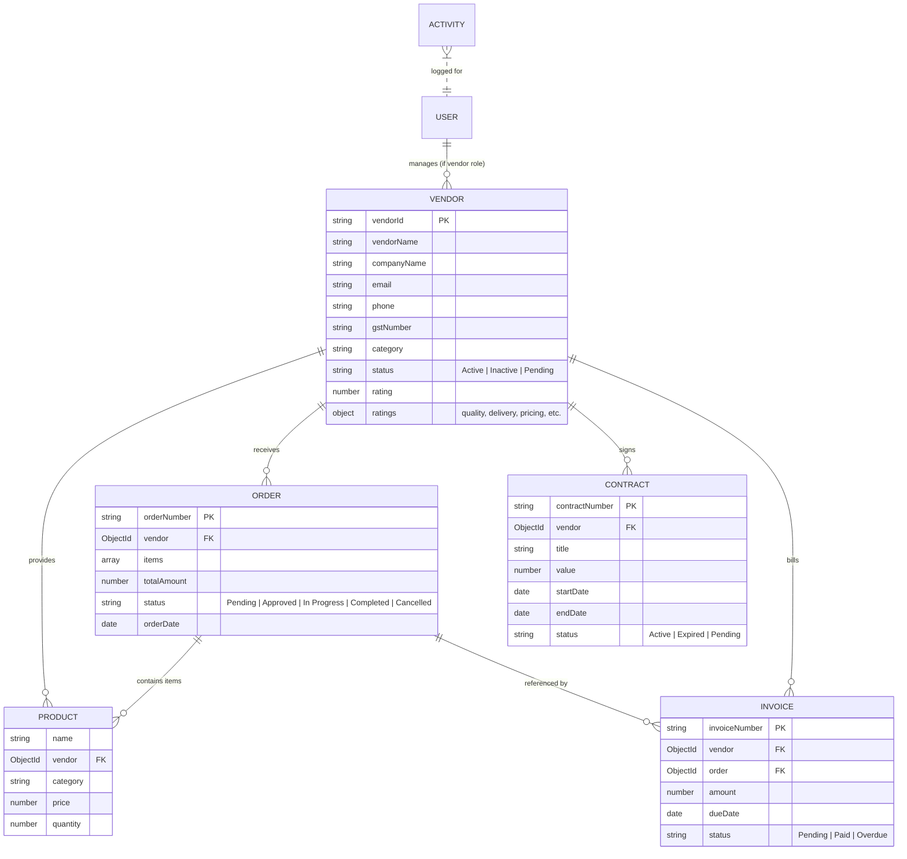

# Vendom — Enterprise Vendor Management System (VMS)

[](https://react.dev/)
[](https://nodejs.org/)
[](https://www.mongodb.com/)
[](LICENSE)

**Vendom** is a modern, full-stack **Vendor Management System** designed to streamline procurement, vendor relationship management (VRM), contract tracking, order fulfillment, and invoicing in one centralized dashboard.

Built with a responsive, high-performance **MERN** architecture (MongoDB, Express, React, Node.js), Vendom features **Zero-Configuration Startup** with automatic in-memory database fallback and pre-seeded demo records for hassle-free demonstration.

---

## Table of Contents

- [1. Key Features & Modules](#1-key-features--modules)
- [2. System Architecture](#2-system-architecture)
- [3. Tech Stack](#3-tech-stack)
- [4. Project Structure](#4-project-structure)
- [5. Getting Started & Installation](#5-getting-started--installation)
  - [Prerequisites](#prerequisites)
  - [One-Click Launch (Windows)](#one-click-launch-windows)
  - [Standard Setup (npm)](#standard-setup-npm)
- [6. Environment Configuration](#6-environment-configuration)
- [7. Default Demo Accounts](#7-default-demo-accounts)
- [8. System Workflow & User Roles](#8-system-workflow--user-roles)
- [9. API Reference](#9-api-reference)
- [10. Data Models & Schemas](#10-data-models--schemas)
- [11. Common Troubleshooting](#11-common-troubleshooting)

---

## 1. Key Features & Modules

### 🏢 Vendor Directory & Lifecycle
- Comprehensive vendor profiles including GST numbers, city, state, contact person, phone, and services.
- Search, filter by category (e.g., *IT Services, Office Supplies, Logistics*), and filter by status (*Active, Inactive, Pending*).
- Status toggling with automated business guardrails (e.g., inactive vendors cannot be assigned new orders).

### 📊 Real-Time Operations Dashboard
- Live KPI cards: Total Vendors, Active Vendors, Total Products, Open Orders, and Pending Approval volume.
- Spend analytics, recent audit activity feeds, and quick navigation shortcuts.
- **Reset Demo Data** button to quickly restore sample records for testing or presentations.

### 📦 Products & Services Catalog
- Manage company procurement items and vendor-offered services with unit pricing in Indian Rupees (₹ INR).
- Category classification, stock inventory levels, and direct vendor association.

### 📋 Purchase Order (PO) Management
- End-to-end purchase order lifecycle tracking:
  $$\text{Pending} \longrightarrow \text{Approved} \longrightarrow \text{In Progress} \longrightarrow \text{Completed / Cancelled}$$
- Line item calculation, automated stock validation, delivery dates, and printable purchase order receipts.

### 📑 Contract & SLA Management
- Legal agreements and vendor contract repository.
- Contract start/end dates, total contract valuation (₹ INR), terms documentation, and real-time status tracking (*Active, Expired, Pending*).

### 🧾 Invoicing & Accounts Payable
- Invoice generation mapped to vendors and purchase orders.
- Billing amounts, payment due date tracking, and status monitoring (*Paid, Pending, Overdue*).

### ⭐ 6-Dimension Performance Scorecard
- Multi-metric vendor ratings evaluating:
  - **Quality**
  - **Delivery Timeliness**
  - **Pricing Competitiveness**
  - **Communication**
  - **Reliability**
  - **Compliance**
- Automated calculation of overall star ratings (1.0 – 5.0) with visual scorecards.

### 👥 User Administration & Role-Based Access Control (RBAC)
- **Admin Role:** Full administrative access across all records, configuration, order approvals, and user accounts.
- **Vendor Role:** Restricted access allowing vendors to manage only their own products/services, view their assigned orders, and update order statuses.

### ⚡ Built-in Zero-Config In-Memory Database
- Automatically detects if local MongoDB is running. If not detected, seamlessly launches an embedded **MongoMemoryServer** and seeds 20 realistic vendor companies, users, products, contracts, and invoices automatically.

---

## 2. System Architecture

```text
┌────────────────────────────────────────────────────────┐
│                   React 19 Frontend                    │
│      (Vite, Lucide Icons, Responsive CSS Layout)       │
└───────────────────────────┬────────────────────────────┘
                            │ REST API (JSON / JWT)
                            ▼
┌────────────────────────────────────────────────────────┐
│                   Express.js Backend                   │
│        (Node.js, JWT Auth, Role-Based Middleware)      │
└───────────────────────────┬────────────────────────────┘
                            │ Mongoose ODM
                            ▼
        ┌───────────────────┴───────────────────┐
        ▼                                       ▼
┌───────────────────────┐             ┌──────────────────────┐
│  Local MongoDB Server │   Fallback  │ Embedded In-Memory   │
│  (127.0.0.1:27017)    │ ──────────> │ MongoDB Database     │
└───────────────────────┘             └──────────────────────┘
```

---

## 3. Tech Stack

| Layer | Technology | Details |
|---|---|---|
| **Frontend** | React 19, Vite 6 | Fast SPA rendering and modern hooks architecture |
| **Icons & UI** | Lucide React | Clean, professional SVG interface icons |
| **Styling** | Vanilla CSS3 | Custom responsive design system with dark/light tones |
| **Backend** | Node.js, Express.js (v4) | RESTful API server with modular routing |
| **Database** | MongoDB / Mongoose (v8) | Document-oriented database with schema validation |
| **Fallback DB** | MongoMemoryServer (v11) | In-memory ephemeral DB for zero-dependency demos |
| **Security** | JWT, bcryptjs, CORS | Bearer token authentication & hashed passwords |
| **Process Runner**| Concurrently | Runs both backend and frontend servers simultaneously |

---

## 4. Project Structure

```text
Vendor-Management-System/
├── package.json                 # Top-level workspace dependencies & dev runner
├── README.md                    # Project documentation (this file)
├── backend/
│   ├── models/                  # Mongoose data schemas
│   │   ├── Activity.js          # Audit activity trail
│   │   ├── Contract.js          # Vendor legal contracts
│   │   ├── Invoice.js           # Billing and payment records
│   │   ├── Order.js             # Purchase orders
│   │   ├── Product.js           # Catalog items & services
│   │   ├── User.js              # Admin & Vendor users
│   │   └── Vendor.js            # Vendor profiles & ratings
│   ├── routes/                  # Express REST API endpoints
│   │   ├── activities.js        # /api/activities
│   │   ├── auth.js              # /api/auth
│   │   ├── contracts.js         # /api/contracts
│   │   ├── dashboard.js         # /api/dashboard
│   │   ├── invoices.js          # /api/invoices
│   │   ├── orders.js            # /api/orders
│   │   ├── products.js          # /api/products
│   │   ├── users.js             # /api/users
│   │   └── vendors.js           # /api/vendors
│   ├── middleware/              # Auth & role verification middleware
│   ├── seed.js                  # Automated 20-vendor demo database seeder
│   ├── server.js                # Express server entry point & DB fallback
│   ├── .env                     # Backend environment configuration
│   └── package.json             # Backend dependencies & npm scripts
└── frontend/
    ├── src/
    │   ├── components/
    │   │   └── Sidebar.jsx      # Navigation sidebar with role indicator
    │   ├── services/
    │   │   └── api.js           # Centralized API fetch helper
    │   ├── App.jsx              # Application pages, modals & state
    │   ├── main.jsx             # React DOM root entry
    │   ├── styles.css           # Global design system & component styles
    │   └── utils.js             # Currency formatting (INR) & utilities
    ├── index.html               # Frontend HTML template
    ├── vite.config.js           # Vite configuration
    └── package.json             # Frontend dependencies & scripts
```

---

## 5. Getting Started & Installation

### Prerequisites
- **Node.js**: v18.0.0 or higher ([Download Node.js](https://nodejs.org/))
- **MongoDB** *(Optional)*: Community Server running locally. If not installed or running, the system will seamlessly run via its built-in in-memory database!

---

### One-Click Launch (Windows)

From the project root directory, double-click or run:

```powershell
..\run.bat
```

---

### Standard Setup (npm)

1. **Install all dependencies** across root, backend, and frontend:
   ```bash
   npm run install:all
   ```

2. **Start the application** in development mode:
   ```bash
   npm run dev
   ```

3. **Access the application**:
   - **Frontend App:** [http://localhost:5173](http://localhost:5173)
   - **Backend API:** [http://localhost:5000](http://localhost:5000)
   - **API Health Check:** [http://localhost:5000/api/health](http://localhost:5000/api/health)

*(Optional) To run backend and frontend separately:*
```bash
# Terminal 1 - Backend
npm run dev --prefix backend

# Terminal 2 - Frontend
npm run dev --prefix frontend
```

---

## 6. Environment Configuration

The backend reads configuration from `backend/.env`.

Default configuration:
```env
PORT=5000
MONGO_URI=mongodb://127.0.0.1:27017/vendor-management
JWT_SECRET=super-secret-jwt-key-for-vendom-system-2025
CLIENT_URL=http://localhost:5173
```

- `PORT`: Express server listening port (default: `5000`).
- `MONGO_URI`: MongoDB connection string. If unreachable, the server falls back to `mongodb-memory-server`.
- `JWT_SECRET`: Secret key used for signing JSON Web Tokens.
- `CLIENT_URL`: Allowed CORS origin for frontend communication.

---

## 7. Default Demo Accounts

When the system initializes for the first time, it automatically creates sample accounts:

| Role | Email Address | Password | Permissions |
|---|---|---|---|
| **System Administrator** | `admin@vendom.com` | `admin123` | Full access to all modules, orders, vendors, contracts, invoices, and users |
| **Vendor User** | `vendor@northstar.test` | `vendor123` | Scoped access to Northstar Supplies' products and orders |
| **Vendor User 2** | `tech@bluepeak.test` | `vendor123` | Scoped access to BluePeak Technologies' catalog and orders |

---

## 8. System Workflow & User Roles

### Administrator Workflow:
1. **Login:** Authenticate with `admin@vendom.com` / `admin123`.
2. **Review Metrics:** View dashboard analytics, spend summaries, and system activity logs.
3. **Onboard Vendors:** Add new vendors with GST, category, and contact details.
4. **Approve Contracts & Orders:** Create contracts, track order progress through each stage, and generate invoices.
5. **Rate Performance:** Update vendor scorecards across quality, delivery, and compliance.

### Vendor Portal Workflow:
1. **Login:** Authenticate with `vendor@northstar.test` / `vendor123`.
2. **Catalog Management:** Add and update products/services offered by the vendor.
3. **Order Fulfillment:** Review incoming purchase orders and update statuses (*In Progress*, *Completed*).
4. **Restricted Privacy:** Vendor cannot view or modify data belonging to other vendors.

---

## 9. API Reference

All API routes require `Authorization: Bearer <token>` header except public authentication routes.

### Authentication (`/api/auth`)
- `POST /api/auth/login` — Authenticate user and receive JWT token.
- `GET /api/auth/me` — Fetch currently logged-in user profile.

### Dashboard (`/api/dashboard`)
- `GET /api/dashboard` — Fetch aggregate stats, order counts, and category breakdowns.
- `POST /api/dashboard/reset-demo` — Reset and re-seed the demo database *(Admin only)*.

### Vendors (`/api/vendors`)
- `GET /api/vendors` — List all vendors (supports `?search=`, `?status=`, `?category=`).
- `GET /api/vendors/:id` — Get vendor profile by ID.
- `POST /api/vendors` — Create a new vendor record *(Admin)*.
- `PUT /api/vendors/:id` — Update vendor information.
- `PUT /api/vendors/:id/ratings` — Update 6-metric rating scorecard *(Admin)*.
- `PATCH /api/vendors/:id/status` — Toggle vendor status (*Active* / *Inactive*).
- `DELETE /api/vendors/:id` — Delete vendor *(Admin)*.

### Products & Services (`/api/products`)
- `GET /api/products` — Retrieve all products/services.
- `POST /api/products` — Create a new product.
- `PUT /api/products/:id` — Update product details and inventory.
- `DELETE /api/products/:id` — Delete product.

### Purchase Orders (`/api/orders`)
- `GET /api/orders` — List purchase orders.
- `GET /api/orders/:id` — Get detailed purchase order.
- `POST /api/orders` — Create new purchase order *(Admin)*.
- `PATCH /api/orders/:id/status` — Advance order status (*Pending*, *Approved*, *In Progress*, *Completed*, *Cancelled*).
- `DELETE /api/orders/:id` — Remove order *(Admin)*.

### Contracts (`/api/contracts`)
- `GET /api/contracts` — List all vendor contracts.
- `POST /api/contracts` — Register a new contract *(Admin)*.
- `PUT /api/contracts/:id` — Update contract terms and values *(Admin)*.
- `PATCH /api/contracts/:id/status` — Change contract status *(Active, Expired, Terminated)*.
- `DELETE /api/contracts/:id` — Delete contract *(Admin)*.

### Invoices (`/api/invoices`)
- `GET /api/invoices` — List all invoices.
- `POST /api/invoices` — Issue new invoice *(Admin)*.
- `PUT /api/invoices/:id` — Update invoice information.
- `PATCH /api/invoices/:id/status` — Update payment status (*Pending*, *Paid*, *Overdue*).
- `DELETE /api/invoices/:id` — Delete invoice *(Admin)*.

### Users & Audit (`/api/users`, `/api/activities`)
- `GET /api/users` — List system user accounts *(Admin)*.
- `POST /api/users` — Create user account *(Admin)*.
- `DELETE /api/users/:id` — Remove user account *(Admin)*.
- `GET /api/activities` — Fetch recent system audit trail.

---

## 10. Data Models & Schemas



---

## 11. Common Troubleshooting

| Issue | Cause | Resolution |
|---|---|---|
| **EADDRINUSE: port 5000 or 5173** | Another server is already running on port 5000 or 5173 | Stop existing node processes or terminate them using Task Manager / PowerShell (`Get-Process node \| Stop-Process`). |
| **Local MongoDB not connected** | MongoDB service is stopped or not installed | No action required! The application automatically boots an embedded in-memory MongoDB server. If you prefer persistent local data, start the service with `Start-Service MongoDB`. |
| **CORS Error in Browser** | Backend origin mismatch | Confirm `CLIENT_URL=http://localhost:5173` is set in `backend/.env`. |
| **Invalid Login Credentials** | Using non-demo credentials | Use `admin@vendom.com` / `admin123` or click **Reset Demo Data** from the admin dashboard. |
| **Cannot Create Order for Vendor** | Vendor is marked Inactive | Change vendor status to **Active** before creating a purchase order. |

---

## License

This project is open-source and available under the [MIT License](LICENSE).
